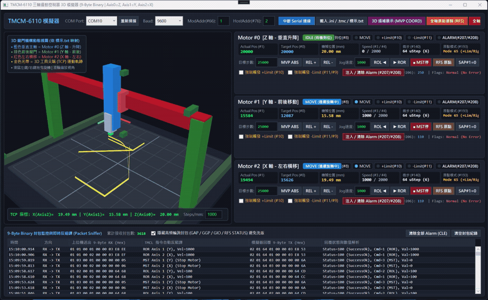

# TMCM-6110 3-Axis Motion Controller 3D Simulator


**[English](#english) | [繁體中文](#繁體中文)**



---

<a id="english"></a>
## English

### Overview

A standalone Windows **Digital Twin & Virtual Commissioning 3D Simulator** for the **Trinamic (ADI) TMCM-6110** 6-axis stepper motor controller, built with C# and .NET 8.0.

It enables motion control & host software developers to develop, test, and verify **9-Byte Binary TMCL** host applications without physical hardware or the risk of mechanical collisions—complete with a hardware-accelerated native WPF 3D XYZ gantry visualizer, live Packet Sniffer, and interactive hardware fault injection.

### Demo Video

- Watch the full highlight clip (~27s, 1.6 MB): [`demo_highlight.mp4`](./demo_highlight.mp4)


https://github.com/user-attachments/assets/3f8b5a76-0ad5-4a7a-8779-d88812af3ebb


### Key Features

1. **9-Byte Binary TMCL Protocol Engine**:
   - Full framing, 8-bit additive checksum validation, and sliding-window synchronization per [`TMCL_reference.pdf`](./TMCL_reference.pdf).
   - Retains all 6 axes (`Axis 0..5`) internally so multi-axis initialization and polling never time out.
   - Default active 3-axis gantry mapping:
     - **Motor #0 (`Axis 0`) = Z-Axis** (Vertical spindle, Blue)
     - **Motor #1 (`Axis 1`) = Y-Axis** (Front/Back gantry bridge, Green)
     - **Motor #2 (`Axis 2`) = X-Axis** (Left/Right carriage, Red)
2. **Dual Transport (Serial Port + Zero-Driver TCP)**:
   - **Serial COM Port**: Connects seamlessly to your host app via virtual COM port pairs (e.g., `com0com` `COM10 <-> COM11`).
   - **Local TCP Server (`127.0.0.1:4001`)**: Starts automatically for instant zero-driver loopback testing.
3. **Native WPF `Viewport3D` Gantry & TCP Trajectory Ribbon**:
   - **Zero third-party 3D dependencies**—compiles cleanly in offline/air-gapped environments.
   - Renders real-time Z/Y/X stage motion, 3D limit switch status blocks, orbit camera controls, and a golden 3D **Tool Center Point (TCP)** trajectory trail.
4. **Motion States, Async Events & Fault Injection**:
   - **Position Reached**: Supports both polling (`GAP 8, <axis>`) and **Command `138`** asynchronous push notifications (immediate `Status=100` ACK followed by an unsolicited `Status=128 (0x80)` packet upon arrival).
   - **Virtual & Forced Limit Switches (`+Limit #10` / `-Limit #11` / `#9`)**: Automatic trip beyond virtual travel bounds (`±100,000 steps` default) or manual UI override checkboxes.
   - **Alarm Fault Injection (`#207` StallGuard2 / `#208` TMC262 Driver Error)**: One-click alarm injection and immediate emergency stop to verify host recovery (`CLE`, Cmd `36`).
5. **Live 9-Byte Packet Sniffer & Disassembler**:
   - Real-time RX/TX Hex viewer with automatic TMCL mnemonic disassembly and optional polling packet filter (`GAP`, `GGP`, `GIO`, `RFS STATUS`).
6. **Instant Bilingual UI (`English` / `繁體中文`)**:
   - Auto-detects Windows UI culture on startup and includes a one-click **`🌐 EN / 繁中`** toggle in the toolbar.

### Supported TMCL Commands & Parameters

| Category | Supported Commands / Features |
| :--- | :--- |
| **Motion** | `ROR (1)`, `ROL (2)`, `MST (3)`, `MVP (4)` (`ABS`, `REL`, `COORD` incl. `$47` 3-axis linear interpolation) |
| **Parameters** | `SAP (5)`, `GAP (6)`, `STAP (7)`, `RSAP (8)`, `SGP (9)`, `GGP (10)`, `STGP (11)`, `RSGP (12)` |
| **Reference Search** | `RFS (13)` (`START`, `STOP`, `STATUS`), including Mode `65` (`+Limit` homing) |
| **I/O & Coordinates** | `SIO (14)`, `GIO (15)`, `SCO (30)`, `GCO (31)`, `CCO (32)` |
| **System & Events** | `CLE (36)`, `GetAppStatus (135)`, `GetFirmwareVersion (136)`, `RequestTargetPositionReachedEvent (138)` |

### Getting Started

#### Prerequisites
- Windows 10 / 11
- [.NET 8.0 SDK](https://dotnet.microsoft.com/download/dotnet/8.0) (or Visual Studio 2022 with **.NET desktop development** workload)

#### Build & Run
- **Visual Studio 2022**: Open `Tmcm6110Simulator.sln`, set `Tmcm6110.App` as the startup project, and press `F5`.
- **.NET CLI**:
  ```powershell
  dotnet build Tmcm6110Simulator.sln
  dotnet run --project src/Tmcm6110.App
  ```
- **Run Automated Self-Test**:
  ```powershell
  dotnet run --project src/Tmcm6110.HostTester -- --self-test
  ```

### Connecting Your Host Application

1. **Via Virtual Serial Port (`com0com` / VSPD)**:
   - Create a linked COM port pair (e.g., `COM10 <===> COM11`).
   - In `Tmcm6110.App`, select `COM11`, set baud rate (e.g., `9600` or `115200`), verify `ModAddr=1` and `HostAddr=2`, and click **Open Serial Port**.
   - Point your host software (or `Tmcm6110.HostTester`) to `COM10`.
2. **Via Local TCP (`127.0.0.1:4001`)**:
   - Run `dotnet run --project src/Tmcm6110.HostTester` and choose option `[2]` to test commands immediately without installing virtual COM drivers.

### Custom Configuration Loading (`.ini` / `.tmc` / Axis Mapping `.txt`)

- You can load TMCL-IDE Setup Wizard `.ini` exports, `.tmc` (`SAP`/`SGP`) scripts, or axis-mapping `.txt` files at runtime via the **Load .ini / .tmc** button.
- Note: `.ini`, `.tmc`, and private axis-mapping files are excluded in `.gitignore` so machine-specific parameters remain private on your local disk.

### Custom Development & Commercial Inquiries

Looking for custom industrial software, virtual commissioning tools, or motion-control solutions? Feel free to reach out for project inquiries or consulting:

- **Email**: [dicokabn@gmail.com](mailto:dicokabn@gmail.com)
- **Services**:
  - Custom **C# / .NET (WPF)** host software & industrial HMI development
  - **Motion Controller Simulators & Virtual Commissioning** (Trinamic, Delta, Advantech, Galil, Modbus / EtherCAT, etc.)
  - Custom **Serial / CAN / TCP** protocol drivers & 3D Digital Twin visualization

---

<a id="繁體中文"></a>
## 繁體中文

### 專案簡介

本專案為針對 **Trinamic (ADI) TMCM-6110** 六軸步進馬達控制器所開發的獨立 Windows **數位孿生（Digital Twin）與虛擬調試 3D 模擬器**，採用 C# / .NET 8.0 與原生 WPF 開發。

專為運動控制上位機開發者設計，讓您在**沒有實體控制板或機台尚未組裝完成時**，即可透過 **9-Byte Binary TMCL 協定**進行完整通訊驗證、3D 運動軌跡視覺化與異常故障測試，零撞機風險。

### 操作展示影片

- 精華操作短片（約 27 秒，1.6 MB）：[`demo_highlight.mp4`](./demo_highlight.mp4)
https://github.com/user-attachments/assets/3f8b5a76-0ad5-4a7a-8779-d88812af3ebb
### 核心特色

1. **完整 9-Byte Binary 二進制封包引擎**：
   - 依循 [`TMCL_reference.pdf`](./TMCL_reference.pdf) 規範實作 9-Byte 指令解析、8-bit 累加 Checksum 驗證與滑動視窗 Frame 同步。
   - 內部完整保留 `Axis 0~5` 暫存器與回應能力，上位機初始化輪詢全部 6 軸不會發生 Timeout。
   - 預設三軸龍門軸向映射：
     - **Motor #0 (`Axis 0`) = Z 軸**（垂直升降主軸，藍色）
     - **Motor #1 (`Axis 1`) = Y 軸**（前後移動龍門，綠色）
     - **Motor #2 (`Axis 2`) = X 軸**（左右橫移滑座，紅色）
2. **雙傳輸通道支援（Serial Port + 免驅動 TCP Server）**：
   - **Serial COM Port**：搭配虛擬串列埠（如 `com0com` `COM10 <-> COM11`）直接對接既有上位機程式。
   - **本機 TCP Server (`127.0.0.1:4001`)**：啟動即自動監聽，免裝虛擬 COM 驅動即可直接進行本機測試。
3. **原生 WPF `Viewport3D` 3D 龍門機構視窗**：
   - **零第三方 3D 套件依賴**，在離線或內網環境也能直接編譯運行。
   - 即時繪製 Z/Y/X 三軸滑台動態、3D 極限開關紅綠燈塊、滑鼠拖曳旋轉/滾輪縮放視角，以及工具尖端（TCP）**3D 金色運動軌跡光帶**。
4. **運動狀態、非同步到位推播與故障注入**：
   - **到位通知 (Position Reached)**：同時支援輪詢 `GAP 8, <axis>` 與 **`Cmd 138 (0x8A)` 非同步事件推播**（先回傳 `Status=100`，全部目標軸到位後主動推播第 2 筆 `Status=128 (0x80)` 封包）。
   - **虛擬行程與強制極限測試 (`+Limit #10` / `-Limit #11` / `#9`)**：超過預設行程（`±100,000 steps`）自動觸發，或透過 UI 勾選即時強制觸發限位。
   - **Alarm 故障注入 (`#207` StallGuard2 失步 / `#208` TMC262 驅動器錯誤)**：一鍵模擬堵轉與驅動器異常急停，驗證上位機異常處理與 `CLE (Cmd 36)` 清除流程。
5. **即時封包監控與反組譯 (Packet Sniffer)**：
   - 即時顯示 RX/TX 9-Byte Hex 封包與 TMCL 指令自動反組譯，並可一鍵過濾高頻輪詢封包（`GAP` / `GGP` / `GIO` / `RFS STATUS`）。
6. **即時中 / 英雙語介面切換 (`English` / `繁體中文`)**：
   - 啟動時自動依 Windows 系統語系切換，並可在頂部工具列點擊 **`🌐 EN / 繁中`** 按鈕即時切換語言。

### 支援的 TMCL 指令集

| 類別 | 支援指令與功能 |
| :--- | :--- |
| **運動控制** | `ROR (1)`、`ROL (2)`、`MST (3)`、`MVP (4)`（支援 `ABS`、`REL`、`COORD` 含 `$47` 多軸線性插補） |
| **參數存取** | `SAP (5)`、`GAP (6)`、`STAP (7)`、`RSAP (8)`、`SGP (9)`、`GGP (10)`、`STGP (11)`、`RSGP (12)` |
| **原點搜尋** | `RFS (13)`（`START` / `STOP` / `STATUS`，支援 Mode `65` 往 `+Limit` 搜尋原點） |
| **I/O 與座標** | `SIO (14)`、`GIO (15)`、`SCO (30)`、`GCO (31)`、`CCO (32)` |
| **系統與事件** | `CLE (36)`、`GetAppStatus (135)`、`GetFirmwareVersion (136)`、`RequestTargetPositionReachedEvent (138)` |

### 快速開始

#### 環境需求
- Windows 10 / 11
- [.NET 8.0 SDK](https://dotnet.microsoft.com/download/dotnet/8.0)（或 Visual Studio 2022 安裝「**.NET 桌面開發**」工作負載）

#### 編譯與執行
- **Visual Studio 2022**：開啟 `Tmcm6110Simulator.sln`，確認 `Tmcm6110.App` 為啟動專案，按 `F5` 即可啟動。
- **.NET CLI**：
  ```powershell
  dotnet build Tmcm6110Simulator.sln
  dotnet run --project src/Tmcm6110.App
  ```
- **執行自動化自我測試**：
  ```powershell
  dotnet run --project src/Tmcm6110.HostTester -- --self-test
  ```

### 上位機連線方式

1. **透過虛擬串列埠 (`com0com` 或 VSPD)**：
   - 建立一對互連虛擬 COM Port（例如 `COM10 <===> COM11`）。
   - 在 `Tmcm6110.App` 頂部選擇 `COM11`、設定鮑率（如 `9600` 或 `115200`）、確認 `ModAddr=1`、`HostAddr=2`，點擊 **開啟 Serial Port 監聽**。
   - 將您的上位機（或內附 `Tmcm6110.HostTester`）連線至 `COM10` 即可開始雙向通訊。
2. **透過本機 TCP (`127.0.0.1:4001`)**：
   - 直接執行 `dotnet run --project src/Tmcm6110.HostTester` 並選 `[2]`，免安裝任何虛擬串口驅動即可測試所有指令與 `Cmd 138` 非同步推播。

### 載入自訂參數檔 (`.ini` / `.tmc` / 軸向定義 `.txt`)

- 可透過工具列的 **載入設定 (.ini / .tmc)** 按鈕手動載入 TMCL-IDE 匯出的 `.ini`、`.tmc` (`SAP`/`SGP`) 腳本或軸向定義檔；若同層或上層目錄存在本機 `.ini` 檔，啟動時亦會自動偵測載入。
- `.gitignore` 已預設排除所有 `*.ini`、`*.tmc` 與機台軸向定義檔，確保敏感參數不會被上傳至公開 GitHub 儲存庫。

### 客製化開發與專案合作洽詢

若貴公司或團隊有工控上位機開發、虛擬調試模擬器或客製化通訊整合需求，歡迎直接與我聯繫洽談合作或技術顧問服務：

- **聯絡信箱**：[dicokabn@gmail.com](mailto:dicokabn@gmail.com)
- **可承接服務範圍**：
  - **C# / .NET (WPF)** 自動化設備上位機與人機介面（HMI）客製開發
  - **各品牌運動控制模擬器與虛擬調試系統**（如 Trinamic、台達、研華、Galil、Modbus / EtherCAT 等）
  - **Serial / CAN / TCP** 底層通訊協定整合與 **3D 數位孿生（Digital Twin）** 視覺化系統
