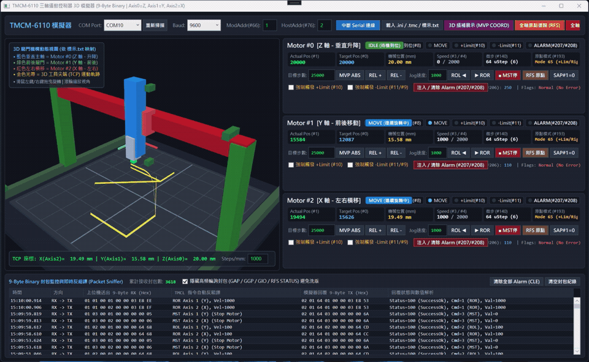

[English](README.md) | **繁體中文**

# TMCM-6110 三軸運動控制器 3D 模擬器


[](./LICENSE)
[](https://github.com/DicoLian/tmcm-6110-3d-simulator/actions/workflows/release.yml)



## 專案簡介

本專案為針對 **Trinamic (ADI) TMCM-6110** 六軸步進馬達控制器所開發的獨立 Windows **數位孿生（Digital Twin）與虛擬調試 3D 模擬器**，採用 C# / .NET 8.0 與原生 WPF 開發。專為運動控制上位機開發者設計，讓您在**沒有實體控制板或機台尚未組裝完成時**，即可透過 **9-Byte Binary TMCL 協定**完成通訊驗證、原生 3D 龍門軌跡視覺化與互動式異常故障測試，零撞機風險。

## 核心亮點

- **完整 9-Byte Binary TMCL 協定引擎**：依循 [`TMCL_reference.pdf`](./TMCL_reference.pdf) 實作封包解析、8-bit 累加 Checksum 驗證與滑動視窗同步，內部完整保留 `Axis 0~5` 暫存器，上位機輪詢全部 6 軸絕不 Timeout。
- **雙傳輸通道（Serial COM + 免驅動 TCP Server）**：支援搭配虛擬串列埠（`com0com` `COM10 <-> COM11`）對接既有上位機，亦內建自動啟動的本機 TCP Server（`127.0.0.1:4001`）。
- **原生 WPF `Viewport3D` 3D 龍門機構視窗**：零第三方 3D 套件依賴，離線內網亦可直接編譯；即時呈現 Z/Y/X 三軸動態、3D 極限開關燈號、自由旋轉視角與工具尖端（TCP）**3D 金色軌跡光帶**。
- **非同步到位推播與故障注入**：同時支援 `GAP 8` 輪詢與 `Cmd 138` 非同步到位推播（`Status=100` 回覆 + 主動推播 `Status=128`）、虛擬與強制極限開關（`+Limit #10` / `-Limit #11` / `#9`），以及 StallGuard2（`#207`）/ TMC262（`#208`）異常注入與 `CLE (Cmd 36)` 清除復歸。
- **即時封包監控與中英雙語介面**：即時顯示 RX/TX 9-Byte Hex 與 TMCL 反組譯、支援輪詢封包過濾，並提供工具列一鍵 **`🌐 EN / 繁中`** 語言切換。

## 快速開始（免硬體 / 3 步驟上手）

### 方式 A — 直接下載執行檔（免安裝編譯器）

1. 前往 [GitHub Releases](https://github.com/DicoLian/tmcm-6110-3d-simulator/releases) 下載最新版本的 `win-x64` `.zip` 壓縮檔並解壓縮。
2. 雙擊 `Tmcm6110.App.exe` 啟動 3D 模擬器（本機 TCP `127.0.0.1:4001` 會自動開始監聽）。
3. 執行 `Tmcm6110.HostTester.exe` 並選擇 **`[2]`**（本機 TCP `127.0.0.1:4001`），即可立即看到 3D 龍門機構開始移動。

> **提示**：由於開源釋出的執行檔未經商業憑證簽章，首次執行時 Windows SmartScreen 可能會跳出提醒，點擊 **「其他資訊 → 仍要執行」** 即可。

### 方式 B — 從原始碼建置與執行

環境需求：Windows 10 / 11 與 [.NET 8.0 SDK](https://dotnet.microsoft.com/download/dotnet/8.0)（或安裝「**.NET 桌面開發**」工作負載的 Visual Studio 2022）：

```powershell
dotnet build Tmcm6110Simulator.sln
dotnet run --project src/Tmcm6110.App
# 在第二個終端機執行測試端，並選擇 [2]（本機 TCP 127.0.0.1:4001）：
dotnet run --project src/Tmcm6110.HostTester
```

- **Visual Studio 2022**：開啟 `Tmcm6110Simulator.sln`，將 `Tmcm6110.App` 設為啟動專案後按 `F5`。
- **執行自動化自我測試**：
  ```powershell
  dotnet run --project src/Tmcm6110.HostTester -- --self-test
  ```

---

## 操作展示影片

- 精華操作短片（約 27 秒，1.6 MB）：[`demo_highlight.mp4`](./demo_highlight.mp4)

https://github.com/user-attachments/assets/3f8b5a76-0ad5-4a7a-8779-d88812af3ebb

## 功能與架構細節

1. **預設三軸龍門軸向映射（保留完整 6 軸狀態）**：
   - **Motor #0 (`Axis 0`) = Z 軸**（垂直升降主軸，藍色）
   - **Motor #1 (`Axis 1`) = Y 軸**（前後移動龍門，綠色）
   - **Motor #2 (`Axis 2`) = X 軸**（左右橫移滑座，紅色）
   - `Axis 3~5` 內部狀態完整保留，確保上位機初始化輪詢全部 6 軸時均能正常回應。
2. **運動狀態、非同步事件與故障注入**：
   - **到位通知 (Position Reached)**：同時支援輪詢 `GAP 8, <axis>` 與 **`Cmd 138 (0x8A)` 非同步事件推播**（先回傳 `Status=100`，全部目標軸到位後主動推播第 2 筆 `Status=128 (0x80)` 封包）。
   - **虛擬行程與強制極限測試 (`+Limit #10` / `-Limit #11` / `#9`)**：超過預設虛擬行程（`±100,000 steps`）自動觸發，或透過 UI 勾選即時強制觸發限位。
   - **Alarm 故障注入 (`#207` StallGuard2 失步 / `#208` TMC262 驅動器錯誤)**：一鍵模擬堵轉與驅動器異常急停，驗證上位機異常處理與 `CLE (Cmd 36)` 清除流程。
3. **即時封包監控與中英雙語介面**：
   - 即時顯示 RX/TX 9-Byte Hex 封包與 TMCL 指令自動反組譯，並可一鍵過濾高頻輪詢封包（`GAP` / `GGP` / `GIO` / `RFS STATUS`）。
   - 啟動時自動依 Windows 系統語系切換，並可在頂部工具列點擊 **`🌐 EN / 繁中`** 按鈕即時切換語言。

## 支援的 TMCL 指令集

| 類別 | 支援指令與功能 |
| :--- | :--- |
| **運動控制** | `ROR (1)`、`ROL (2)`、`MST (3)`、`MVP (4)`（支援 `ABS`、`REL`、`COORD` 含 `$47` 多軸線性插補） |
| **參數存取** | `SAP (5)`、`GAP (6)`、`STAP (7)`、`RSAP (8)`、`SGP (9)`、`GGP (10)`、`STGP (11)`、`RSGP (12)` |
| **原點搜尋** | `RFS (13)`（`START` / `STOP` / `STATUS`，支援 Mode `65` 往 `+Limit` 搜尋原點） |
| **I/O 與座標** | `SIO (14)`、`GIO (15)`、`SCO (30)`、`GCO (31)`、`CCO (32)` |
| **系統與事件** | `CLE (36)`、`GetAppStatus (135)`、`GetFirmwareVersion (136)`、`RequestTargetPositionReachedEvent (138)` |

## 上位機連線方式

1. **透過虛擬串列埠 (`com0com` 或 VSPD)**：
   - 建立一對互連虛擬 COM Port（例如 `COM10 <===> COM11`）。
   - 在 `Tmcm6110.App` 頂部選擇 `COM11`、設定鮑率（如 `9600` 或 `115200`）、確認 `ModAddr=1`、`HostAddr=2`，點擊 **開啟 Serial Port 監聽**。
   - 將您的上位機（或內附 `Tmcm6110.HostTester`）連線至 `COM10` 即可開始雙向通訊。
2. **透過本機 TCP (`127.0.0.1:4001`)**：
   - 直接執行 `Tmcm6110.HostTester`（或 `dotnet run --project src/Tmcm6110.HostTester`）並選擇 `[2]`，免安裝任何虛擬串口驅動即可測試所有指令與 `Cmd 138` 非同步推播。

## 載入自訂參數檔 (`.ini` / `.tmc` / 軸向定義 `.txt`)

- 可透過工具列的 **載入設定 (.ini / .tmc)** 按鈕手動載入 TMCL-IDE 匯出的 `.ini`、`.tmc` (`SAP`/`SGP`) 腳本或軸向定義檔；若同層或上層目錄存在本機 `.ini` 檔，啟動時亦會自動偵測載入。
- 專案內附可直接試用的公開範例設定檔：
  - [`samples/demo_gantry.ini`](./samples/demo_gantry.ini) — 通用三軸龍門參數預設檔（`[module_settings_axis%0..2]` 與 `[global_settings]`）。
  - [`samples/demo_gantry.tmc`](./samples/demo_gantry.tmc) — 通用 `SAP` / `SGP` 初始化腳本。
- `.gitignore` 預設排除所有私人 `*.ini`、`*.tmc` 與機台軸向定義檔（僅追蹤 `samples/*.ini` 與 `samples/*.tmc` 公開範例），確保客戶敏感參數不會被上傳至公開儲存庫。

## 客製化開發與專案合作洽詢

若貴公司或團隊有工控上位機開發、虛擬調試模擬器或客製化通訊整合需求，歡迎直接與我聯繫洽談合作或技術顧問服務：

- **聯絡信箱**：[dicokabn@gmail.com](mailto:dicokabn@gmail.com)
- **可承接服務範圍**：
  - **C# / .NET (WPF)** 自動化設備上位機與人機介面（HMI）客製開發
  - **各品牌運動控制模擬器與虛擬調試系統**（如 Trinamic、台達、研華、Galil、Modbus / EtherCAT 等）
  - **Serial / CAN / TCP** 底層通訊協定整合與 **3D 數位孿生（Digital Twin）** 視覺化系統

## 授權條款與第三方聲明

- 本模擬器原始碼採用 [MIT License](./LICENSE) 授權。
- [`TMCL_reference.pdf`](./TMCL_reference.pdf) 版權歸屬 **Analog Devices / Trinamic**，僅作為通訊協定參考文件隨附於本專案中。
- **免責聲明**：本專案為獨立開發的**非官方開源模擬器**，與 **Analog Devices, Inc.** 或 **Trinamic** 無任何隸屬、背書或贊助關係。`TMCM-6110`、`TMCL`、`StallGuard2`、`TMC262` 等名稱與商標均歸屬其各自權利人所有。
